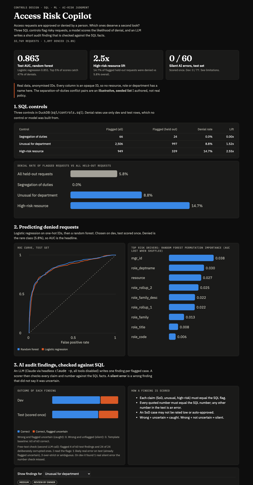

# Access Risk Copilot

**[Open the live dashboard →](https://vanshika1302.github.io/Access-Risk-Copilot/)**

## TL;DR

**Problem.** Access requests get approved or denied by a person. Which ones deserve a second look, and can an LLM explain why without making things up? This project flags risky requests with SQL controls, scores denial risk with ML, has an LLM write an audit finding for each flagged case, and checks every finding against the SQL facts.

| 0.863 | 2.5x | 0 / 60 |
|---|---|---|
| **Test AUC**, random forest predicting denied requests (logistic regression 0.851) | **High-risk-resource lift**: 14.7% of flagged held-out requests were denied vs 5.8% overall | **Silent AI errors** on the held-out test set, scored once (dev: 0 / 77) |



The 0 / 60 is a small sample: with no events in 60 cases the true silent-error rate could still be about 5%. See [Limitations](#limitations).

## Data

[Amazon Employee Access Challenge](https://www.kaggle.com/c/amazon-employee-access-challenge), fetched from OpenML (`Amazon_employee_access`, did 4135, no login): 32,769 real access requests, 9 anonymised ID columns (resource, manager, role and department IDs) and the outcome (1,897 denied, 5.8%). Every column is an opaque ID, so nothing here has a human name. Raw file is in `data/raw/` (gitignored); `python etl/load.py` rebuilds the warehouse.

## What is in it

| Piece | Where | What it does |
|---|---|---|
| SQL controls | `sql/controls.sql`, `etl/` | DuckDB views: segregation of duties, unusual access for a department, high-risk resource |
| ML | `ml/train.py` | Logistic regression then random forest, 60/20/20 stratified split, AUC and top drivers |
| AI layer | `ai/` | `claude -p` writes a finding per flagged case, schema-checked, tools disabled |
| Evals | `ai/scoring.py`, `ai/evaluate.py` | Findings vs SQL facts; test set scored once |
| Dashboard | `dashboard/template.html` → `index.html` | Static page for GitHub Pages |
| Tableau | `tableau/*.csv` | Scored request extract (32,769 rows) and the 60 test findings |

### The three controls
- **Segregation of duties (SoD).** A manager's approved requests for the same resource come from both roles of a conflicting `ROLE_FAMILY` pair. Without an employee ID, "one person holds both" cannot be tested; manager plus resource is the closest real signal. The 6 conflict pairs are an **illustrative, seeded list** (`etl/sod_pairs.py`), not real policy. 66 flags.
- **Unusual access for a department.** The department/resource pair appears exactly once, in a department with at least 300 requests. 2,506 flags (7.6%); 8.8% of the 997 held-out ones were denied (1.5x). My first version flagged 8,521 (26%), too many to review, so I tightened it (see below).
- **High-risk resource.** Top decile of resources by denial rate, using only training rows. 949 flags.

### ML
Chosen on dev, test scored once. Random forest: dev AUC 0.865, **test 0.863**. Logistic regression: dev 0.858, **test 0.851**. Top 5% of test scores contain 55% denials and catch 47% of all denials. Top drivers (random forest permutation importance): manager, department, resource. These are ID columns, so they say where risk concentrates, not why.

### AI layer and evals
Claude (`claude-sonnet-5-5`) runs through Claude Code headless mode, no API key: `--tools ""`, no skills or MCP, no settings, empty working directory, API keys removed from the environment, JSON schema output, recordings replayed from `data/recordings/`. Each finding must set three claims (SoD, unusual, high-risk), quote three numbers, and say if it is uncertain.

The scorer buckets every finding: correct, correct but flagged uncertain, **caught** (wrong, flagged uncertain), **silent** (wrong, not flagged). Errors are: a claim that differs from the SQL flag, a quoted number that differs, any other number in the text, or an SoD case rated low or auto-approved. Prompt v1 was never changed. 77 dev cases and 60 test cases were generated, then the test set was scored once (a second scoring is refused in code).

**Re-run history.** I first ran everything with a looser unusual-access control (26% of requests flagged): 0 silent errors on 77 dev and 60 test cases. I judged that control unreviewable, tightened it, discarded those findings and ran again (kept in `outputs/discarded_v1/`). Because I had seen the first test result, the second test run is not blind in the strict sense. The result did not change.

| Set | Cases | Correct | Correct, flagged uncertain | Caught | Silent |
|---|---|---|---|---|---|
| Dev | 77 | 56 | 21 | 0 | 0 |
| **Test, scored once** | 60 | 42 | 18 | 0 | **0** |

### Free-text check (LLM judge)
The number scorer cannot see a sentence whose numbers are all real but misused (e.g. "137 requests, 132 from the department", where 132 is the department's total, not its share). So a second `claude -p` call judges whether each finding's *text* is supported by the facts. To know whether the judge can see errors at all, I also ran it on 24 genuine findings per split with one false sentence appended (a control that was not triggered, invented history, an invented cause, or an invented comparison).

| Set | Genuine flagged unsupported | Injected errors caught | My reading of the flags |
|---|---|---|---|
| Dev (judge developed here) | 7 of 77 | 24 of 24 | 1 real silent error, 1 borderline, 5 over-strict |
| **Test, run once, judge frozen** | 4 of 60 | 24 of 24 | 1 likely real (already flagged uncertain, so caught), 1 borderline, 1 ambiguous, 1 over-strict |

Judge history: the first version (j1) flagged 50 of 77 genuine findings because it was not told what the writer was told (that a higher risk percentile means a denial is more likely, and what each count field means). Fixing that gave j2, which was then frozen before the test set. The remaining over-strict flags are mostly "the resource owner should review", a recommendation, not a fact. The flags are **adjudicated by me, one reader**, not by a second reviewer. The injected errors are blatant, so 24 of 24 says the judge works on obvious errors, not on subtle ones: for example j1 caught one garbled-number sentence that j2 did not.

**Net:** on the held-out test set there are **0 silent errors by the number scorer** and **no silent free-text error that I found**. On dev there was one free-text silent error (1 of 77) that only the judge found.

## Limitations
- **Small sample.** 0 silent errors in 60 does not mean zero; the 95% upper bound is about 5% (about 2% over all 137).
- The number scorer checks claims and numbers, not wording. A second, LLM-based judge checks the text (below), but its recall on subtle errors is unmeasured and it is itself an LLM.
- The template baseline (fills a sentence from the facts) is correct by construction, so the LLM adds readable explanation, not accuracy. Findings are only as good as the SQL facts they are given.
- Controls are rules I wrote on anonymised IDs. SoD pairs are illustrative; SoD flags only approved requests, so their denial rate is 0 by design. The unusual-access control is weakest in large departments (lift falls as department size rises).
- Findings were written for a sample (137 cases), not all flagged requests, and through a subscription, not the API.
- ML drivers are anonymised IDs and the data is from 2010-2011.

## Tableau
Connect Tableau Public to `tableau/access_requests_scored.csv` (one row per request). Useful fields: `outcome`, `risk_band`, `risk_percentile`, `flag_sod`, `flag_unusual`, `flag_high_risk_resource`, `p_denied_rf`, `split`. Filter `model_scored_out_of_sample = 1` for fair model views (train rows were used to fit the models). Join `ai_findings_test.csv` on `request_id` for the findings.

## Run it
```bash
python3 -m venv .venv && .venv/bin/pip install -r requirements.txt
.venv/bin/python etl/load.py              # warehouse + SQL controls (needs data/raw/amazon_access.arff from OpenML)
.venv/bin/python ml/train.py              # models, AUC, scores
.venv/bin/python -m ai.facts              # case samples
.venv/bin/python -m ai.findings --split dev --live    # live Claude Code calls; omit --live to replay recordings
.venv/bin/python -m ai.evaluate           # scores dev, and test once
.venv/bin/python scripts/export_dashboard.py          # index.html + tableau/ CSVs
.venv/bin/pytest
```
Working rules are in `CLAUDE.md`, choices in `DECISIONS.md`, vocabulary in `GLOSSARY.md`, the plan in `.scratch/access-risk-copilot/`.
